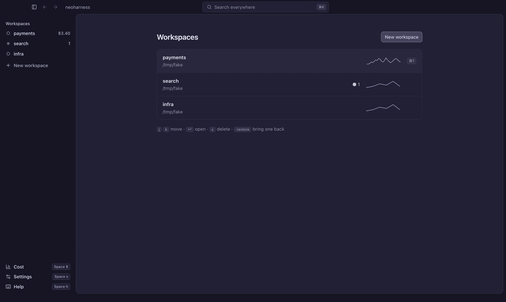

# neoharness

Run several Claude Code sessions at once: a coordinator splits your work into
threads, local or over ssh. Use it from a terminal UI with Vim keys, or from
a macOS app.


## Three concepts

- **Workspace**: one piece of work, usually pinned to a folder. Each
  workspace has a coordinator: a Claude session you write to. It splits your
  request into threads, and sends them corrections and your answers.
- **Thread**: a separate Claude session that does one task, in a local
  folder or on another machine over ssh. The threads pane shows each thread
  and its state (running, waiting on you, idle). You can open any thread and
  write to it directly. Threads report progress, message each other and read
  each other's transcripts.
- **Artifact**: a markdown document an agent writes for you, such as a plan
  or a report. It opens in the window and you can edit it; the agent sees
  your edit as a diff.

Also:

- Permission requests and questions show as cards, and come to you at once.
- Normal Vim motions, operators, search, marks, macros, splits and `:`
  commands. Configuration is in `init.lua`.

neoharness is one program. The hub that runs the sessions is a background
process, as the tmux server is: the first `neoharness` starts it, and turns
run on when you close the TUI. `neoharness hub stop` stops it. Agents talk to
it through an MCP server that it adds to each session, so you change nothing
in your Claude setup.

## Desktop app

The macOS app in `desktop/` shares the same hub, so the TUI and the app show
the same workspaces and threads at the same time.



It has:

- the same Vim keys and `:` commands, or keys as in Claude Code if you turn
  Vim off;
- one search over threads, artifacts, transcripts and commands (`⌘K`);
- a sidebar of workspaces that shows what waits for you; `⌘B` folds it to a
  rail that opens on hover;
- back and forward arrows, as in Slack (`⌘[` `⌘]`, `<C-o>` `<C-i>`);
- the `/model` and `/effort` pickers, with Claude Code's own models and
  versions;
- docs you write in, rendered as you type, that the coordinator works from.

See [docs/desktop.md](docs/desktop.md).

## Download

Every [release](https://github.com/MahammadAgayev/neoharness/releases) has
the `neoharness` binary for macOS, Linux and Windows, and the macOS app for
Apple silicon (`mac-arm64`) and Intel (`mac-x64`). You need `claude` on your
PATH.

1. Put the binary on your PATH, for example:

   ```sh
   tar -xzf neoharness-*-darwin-arm64.tar.gz
   mkdir -p ~/.local/bin && mv neoharness-*/neoharness ~/.local/bin/
   ```

   The app runs this binary for the hub, so install it for the app too.
2. For the app, unzip it and move `neoharness.app` to `~/Applications` or
   `/Applications`. It is signed ad hoc, not notarized, so macOS blocks the
   first open. Click Done, then System Settings → Privacy & Security → Open
   Anyway. Or run once:

   ```sh
   xattr -dr com.apple.quarantine ~/Applications/neoharness.app
   ```

   A binary you downloaded with a browser may need the same command:
   `xattr -d com.apple.quarantine ~/.local/bin/neoharness`.

`checksums.txt` has the SHA-256 of each file.

## Install from source

You need Go 1.26 and `claude` on your PATH.

```sh
git clone https://github.com/MahammadAgayev/neoharness
cd neoharness
./install.sh            # builds to ~/.local/bin; BIN=/other/dir ./install.sh to change
```

On macOS, `./install-mac.sh` installs the desktop app too. It also needs
Node.js and npm (`brew install node`). It builds the TUI as `install.sh`
does, then builds the app and copies it to `~/Applications`
(`APPS=/Applications ./install-mac.sh` to change). Quit the app before you
run it; the hub and its turns go on. The app is signed ad hoc, not
notarized: that is enough on the Mac that built it.

On Windows, run `.\install.ps1` in PowerShell instead. You also need
[Git for Windows](https://git-scm.com/download/win): its `sh` lists the files
for `@` and runs `!` commands. Remote threads use the `ssh` that ships with
Windows.

## Start

```sh
neoharness
```

```
:new demo ~/src/demo    create a workspace pinned to a folder, and open it
:new demo               the same, but pick the folder in a fuzzy picker
i                       write to the coordinator; <CR> sends, <Esc> goes to Normal
<C-w>l                  go to the threads pane; <CR> on a thread opens it, <C-o> goes back
<leader>pt              pick a thread, in any workspace (<leader> is <Space>)
<leader>pa              pick an artifact
:help                   every key and command
```

Ask the coordinator for work, for example "split this refactor into three
threads". It opens the threads, and they show in the pane.

## Configure

Every default key, color and setting is in
[`defaults.lua`](tui/defaults.lua): the model, notifications, the
context warning, the leader and all maps. To change one, copy its line to
`~/.neoharness/init.lua` and edit it. For example:

```lua
neoharness.o.leader = ","
neoharness.keymap.set("n", "gt", ":threads<CR>")
require("neoharness.agents").setup({ claude = { model = "sonnet" } })
```

## Docs

- [Usage](docs/usage.md): workspaces, threads, artifacts, keys, commands
- [Configuration](docs/configuration.md): `init.lua`, environment variables
- [Architecture](docs/architecture.md): the hub, turns, MCP tools,
  permissions, remote threads, data on disk
- [Desktop app](docs/desktop.md): the macOS app, its keys, how to build it
- [Development](docs/development.md): code map, tests, a scratch hub for
  end-to-end runs

The GIF is recorded with [VHS](https://github.com/charmbracelet/vhs) from
[docs/demo/demo.tape](docs/demo/demo.tape), with real agents on a toy
repository in `/tmp`.
