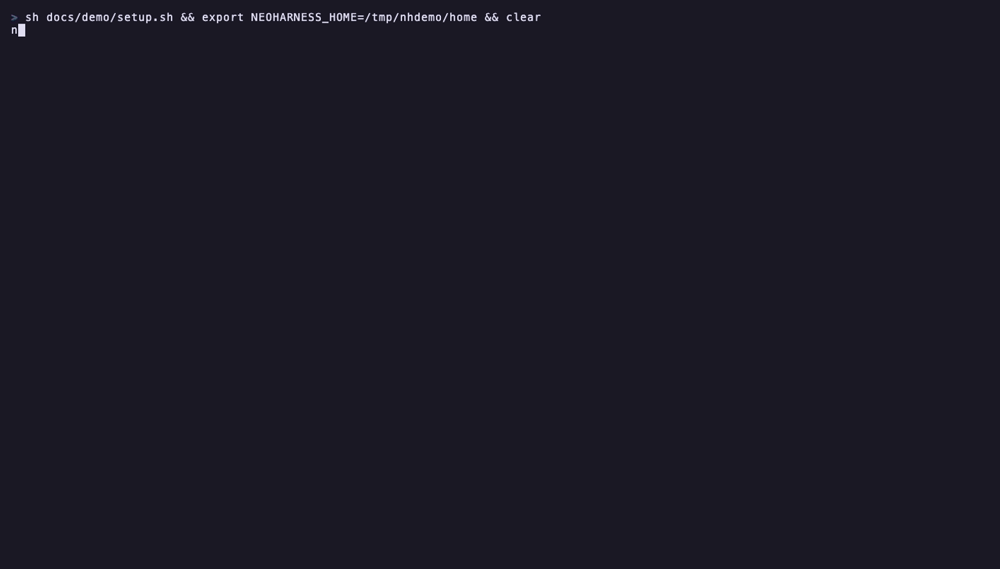

# neoharness

A terminal UI for running several Claude Code sessions at once, with Vim keys.



## Three concepts

- **Workspace**: one piece of work, usually pinned to a folder. Each
  workspace has a coordinator: a Claude session you write to. It splits your
  request into threads, and sends them corrections and your answers.
- **Thread**: a separate Claude session that does one task, in a local
  folder or on another machine over ssh. The threads pane shows each thread
  and its state (running, waiting on you, idle). You can open any thread and
  write to it directly. Threads report progress, message each other and read
  each other's transcripts.
- **Artifact**: a markdown document an agent writes for you, such as a plan
  or a report. It opens in the window and you can edit it; the agent sees
  your edit as a diff.

Also:

- Permission requests and questions show as cards, and come to you at once.
- Normal Vim motions, operators, search, marks, macros, splits and `:`
  commands. Configuration is in `init.lua`.

neoharness is one program. The hub that runs the sessions lives in the TUI
process: no daemon, no tmux. Agents talk to it through an MCP server that it
adds to each session, so you change nothing in your Claude setup.

## Install

You need Go 1.26 and `claude` on your PATH.

```sh
git clone https://github.com/MahammadAgayev/neoharness
cd neoharness
./install.sh            # builds to ~/.local/bin; BIN=/other/dir ./install.sh to change
```

On Windows, run `.\install.ps1` in PowerShell instead. You also need
[Git for Windows](https://git-scm.com/download/win): its `sh` lists the files
for `@` and runs `!` commands. Remote threads use the `ssh` that ships with
Windows.

## Start

```sh
neoharness
```

```
:new demo ~/src/demo    create a workspace pinned to a folder, and open it
:new demo               the same, but pick the folder in a fuzzy picker
i                       write to the coordinator; <CR> sends, <Esc> goes to Normal
<C-w>l                  go to the threads pane; <CR> on a thread opens it, <C-o> goes back
<leader>pt              pick a thread, in any workspace (<leader> is <Space>)
<leader>pa              pick an artifact
:help                   every key and command
```

Ask the coordinator for work, for example "split this refactor into three
threads". It opens the threads, and they show in the pane.

## Configure

Every default key, color and setting is in
[`defaults.lua`](internal/tui/defaults.lua): the model, notifications, the
context warning, the leader and all maps. To change one, copy its line to
`~/.neoharness/init.lua` and edit it. For example:

```lua
neoharness.o.leader = ","
neoharness.keymap.set("n", "gt", ":threads<CR>")
require("neoharness.agents").setup({ claude = { model = "sonnet" } })
```

## Docs

- [Usage](docs/usage.md): workspaces, threads, artifacts, keys, commands
- [Configuration](docs/configuration.md): `init.lua`, environment variables
- [Architecture](docs/architecture.md): the hub, turns, MCP tools,
  permissions, remote threads, data on disk
- [Development](docs/development.md): code map, tests, a scratch hub for
  end-to-end runs

The GIF is recorded with [VHS](https://github.com/charmbracelet/vhs) from
[docs/demo/demo.tape](docs/demo/demo.tape), with real agents on a toy
repository in `/tmp`.
